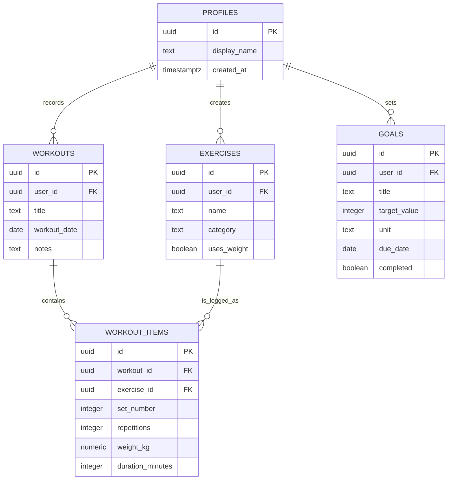

# ER диаграма и начален модел на данните

## Таблици и връзки

| Таблица | Първичен ключ | Основни полета | Връзки |
| --- | --- | --- | --- |
| `profiles` | `id` | `display_name`, `created_at` | `id` е свързан със Supabase Auth потребител |
| `exercises` | `id` | `user_id`, `name`, `category`, `uses_weight` | много упражнения към един профил |
| `workouts` | `id` | `user_id`, `title`, `workout_date`, `notes` | много тренировки към един профил |
| `workout_items` | `id` | `workout_id`, `exercise_id`, `set_number`, `repetitions`, `weight_kg`, `duration_minutes` | много записи към една тренировка и едно упражнение |
| `goals` | `id` | `user_id`, `title`, `target_value`, `unit`, `due_date`, `completed` | много цели към един профил |

## Правила за данните

- `name` на упражнение и `title` на тренировка са задължителни.
- `repetitions`, `set_number` и `duration_minutes` са цели числа, по-големи или равни на 0.
- `weight_kg` е число, по-голямо или равно на 0.
- `workout_items.workout_id` и `workout_items.exercise_id` са външни ключове.
- В Седмица 2 ще се добавят RLS политики: потребителят чете и променя само редове със собствено `user_id`.
