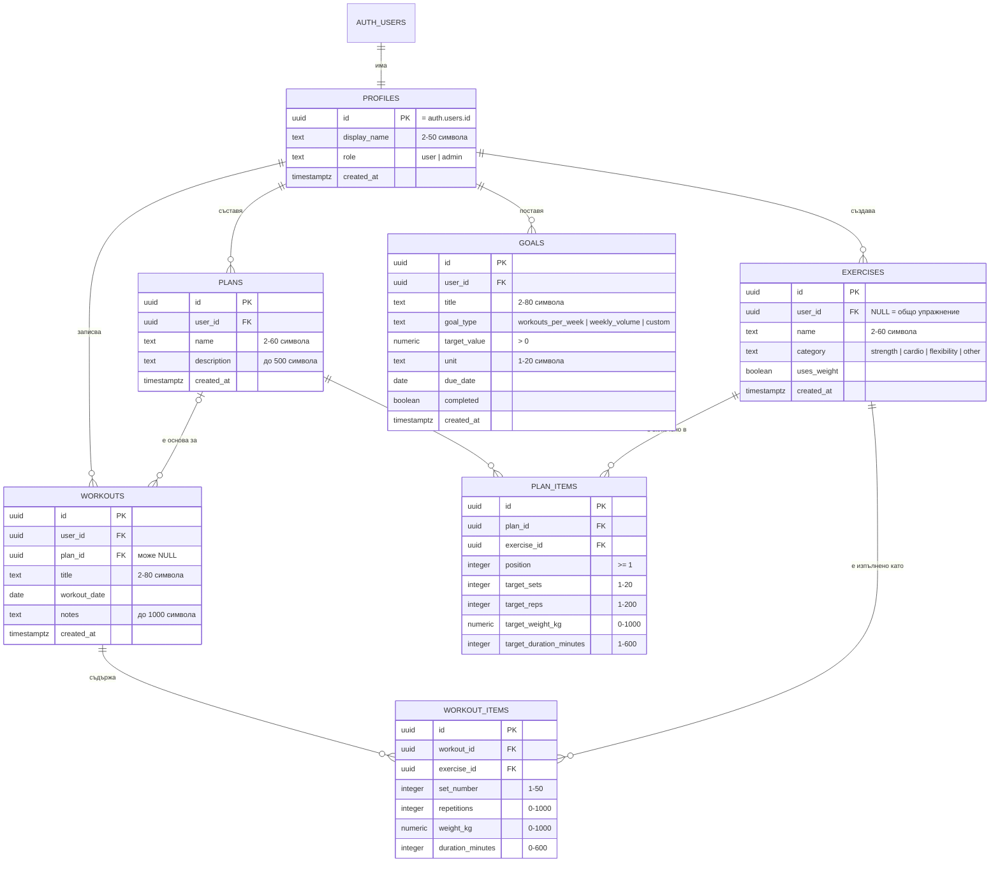

# ER диаграма и модел на данните

Моделът е реализиран в [`database/schema.sql`](../database/schema.sql), а тестовите данни – в [`database/seed.sql`](../database/seed.sql).

В Седмица 2 добавихме таблиците `plans` и `plan_items`. Без тях задължителната функционалност „Планове“ нямаше къде да се пази. Добавихме и поле `role` в `profiles` за потребителски роли.

## Таблици и връзки

| Таблица | Първичен ключ | Външни ключове | Поведение при изтриване |
| --- | --- | --- | --- |
| `profiles` | `id` | `id → auth.users.id` | изтрива се заедно с потребителя |
| `exercises` | `id` | `user_id → profiles.id` | изтриват се с профила; `NULL` = общо упражнение |
| `plans` | `id` | `user_id → profiles.id` | изтриват се с профила |
| `plan_items` | `id` | `plan_id → plans.id`, `exercise_id → exercises.id` | изтриват се с плана; упражнение в план не може да се изтрие |
| `workouts` | `id` | `user_id → profiles.id`, `plan_id → plans.id` | изтриват се с профила; при изтрит план `plan_id` става `NULL` |
| `workout_items` | `id` | `workout_id → workouts.id`, `exercise_id → exercises.id` | изтриват се с тренировката; използвано упражнение не може да се изтрие |
| `goals` | `id` | `user_id → profiles.id` | изтриват се с профила |

## Ограничения (constraints)

- Текстовите полета имат проверка за дължина (`check (char_length(trim(...)) between ...)`).
- Категория, тип цел и роля приемат само изброените стойности.
- Всеки ред в `workout_items` и `plan_items` трябва да има повторения **или** продължителност.
- Повторения, тежест и минути не могат да са отрицателни и имат разумен горен лимит.
- Един потребител не може да има две упражнения с едно и също име (без значение от главни и малки букви). Същото важи и за общите упражнения.
- Профилът се създава автоматично чрез тригер `on_auth_user_created`, когато някой се регистрира.

## RLS политики (Row Level Security)

RLS е включен за всички таблици. Политиките важат само за влезли потребители (`authenticated`). Анонимен посетител не вижда нищо.

| Таблица | Четене | Създаване / промяна / изтриване |
| --- | --- | --- |
| `profiles` | само собствения профил (админ вижда всички) | може да се променя само `display_name` на собствения профил; `role` не може да се смени от приложението |
| `exercises` | общите (`user_id is null`) + собствените | само собствените; общите – само админ |
| `plans`, `workouts`, `goals` | само собствените (`user_id = auth.uid()`) | само собствените |
| `plan_items` | само ако планът е собствен | само в собствен план и само с достъпно упражнение |
| `workout_items` | само ако тренировката е собствена | само в собствена тренировка и само с достъпно упражнение |

Функцията `is_admin()` проверява дали текущият потребител има роля `admin`. Тя е `security definer`, за да няма безкрайна рекурсия в политиката на `profiles`.

## Проверка на политиките

Схемата е изпълнена локално върху PostgreSQL (PGlite) с двама тестови потребители. Проверено е, че:

- вторият потребител вижда 0 тренировки и 0 серии на демо потребителя;
- не може да създаде упражнение от името на друг потребител, нито общо упражнение;
- не може да добави серия в чужда тренировка;
- не може да смени собствената си роля на `admin`;
- нарушенията на ограниченията (отрицателна тежест, серия без повторения и минути, дублирано име) се отхвърлят.
